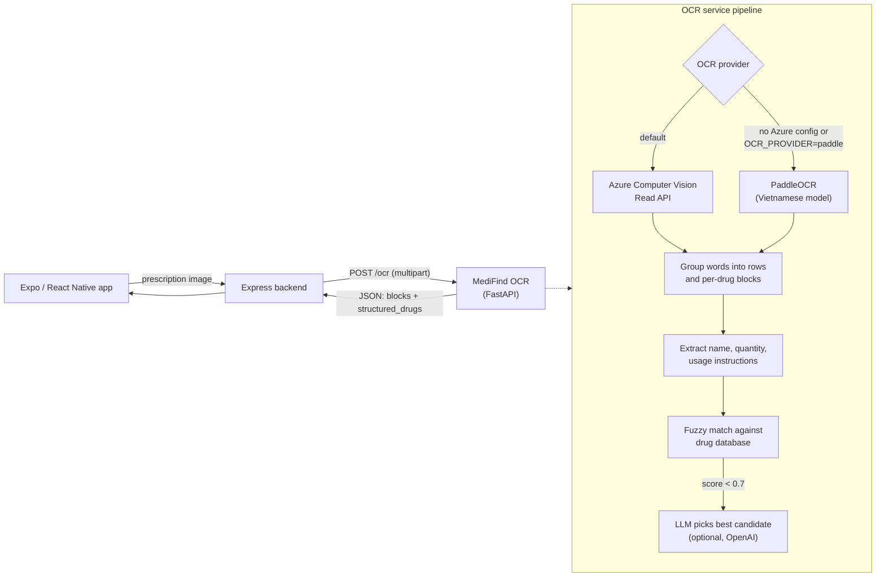

# MediFind OCR

OCR microservice for **MediFind**, a mobile app that reads Vietnamese medical prescriptions and identifies the prescribed drugs. This service receives a photo of a prescription, extracts the text, groups it into one block per drug, and returns structured data (drug name, quantity, usage instructions) matched against a reference drug database.

**Awards:** Third Prize, China–ASEAN Innovation and Entrepreneurship Competition 2024 · Winner, International Innovators Award 2024.

> MediFind is a team project. This repository contains the OCR service only.

## Architecture

MediFind has three components. This service sits behind the backend and is not called by the mobile app directly.

| Component | Stack | Role |
|---|---|---|
| Mobile app | Expo / React Native | User photographs or uploads a prescription |
| Backend | Express (Node.js) | Auth, business logic; forwards images to the OCR service |
| **OCR service (this repo)** | **FastAPI (Python)** | **Text recognition, layout grouping, drug matching** |



## Pipeline

1. **Text recognition**
   - **Azure Computer Vision Read API** (v3.2) is the default engine when `AZURE_OCR_ENDPOINT` and `AZURE_OCR_KEY` are set. The service submits the image and polls the operation until it completes.
   - **PaddleOCR** with the Vietnamese (`lang="vi"`) model, document-orientation and text-line-orientation classifiers is used when Azure is not configured, or when `OCR_PROVIDER=paddle` is set. The model is loaded lazily on the first request.
   - Optional preprocessing (CLAHE + median blur) for dark or blurry photos can be turned on with `USE_PREPROCESS` in `app.py`.
2. **Layout grouping.** Word boxes are grouped into rows by vertical centre, adjacent number/unit tokens are merged (`63` + `viên` → `63 viên`), and rows are split into per-drug blocks whenever a row starts with an item number (`1.`, `2)`) or a large vertical gap appears.
3. **Field extraction.** From each block the service extracts the drug name (first line, minus numbering), the quantity and unit (`viên`, `gói`, `ống`, `chai`, `hộp`, `vỉ`, `lọ`, `tuýp`), and the usage instructions (lines such as *"Ngày uống 3 lần, mỗi lần 1 viên"*).
4. **Drug matching.** Each extracted name is scored against the drug database with a hybrid of sequence similarity, token overlap and a prefix bonus (accent-insensitive).
5. **LLM correction (optional).** If the best fuzzy score is below 0.7 and `OPENAI_API_KEY` is set, the top 5 candidates are sent to an OpenAI model, which picks the most likely one. The `/ocr-with-verification` endpoint additionally asks the model to review all blocks at once.

## API

Interactive docs are served at `http://localhost:8000/docs` (Swagger UI).

| Method | Path | Description |
|---|---|---|
| `GET` | `/health` | Health check |
| `GET` | `/` | Service banner |
| `POST` | `/ocr` | OCR + structured drug extraction |
| `POST` | `/ocr-with-verification` | Same as `/ocr`, plus an LLM review of all blocks |

Both `POST` endpoints take a `multipart/form-data` body with one field, `file`, containing an image (`image/*`).

### `POST /ocr`

```bash
curl -X POST http://localhost:8000/ocr \
  -F "file=@data/sample_prescription.png"
```

Response (abridged):

```json
{
  "id": "3f9c1a7b-2d4",
  "blocks": [
    { "index": 1, "lines": ["Tên đơn vị: TP. Hồ Chí Minh", "Điện thoại: 043432904830", "ĐƠN THUỐC"] },
    { "index": 2, "lines": ["1.YESOM 40 (Esomeprazol 40mg) | 63 viên", "Ngày uống 1 lần, mỗi lần 1 viên"] }
  ],
  "structured_drugs": [
    {
      "drugName": "Esomeprazole 40mg",
      "rawName": "YESOM 40 (Esomeprazol 40mg)",
      "quantity": { "value": "63", "unit": "viên" },
      "usageText": "Ngày uống 1 lần, mỗi lần 1 viên",
      "matchScore": 0.565,
      "source": "fuzzy",
      "blockIndex": 2
    }
  ]
}
```

| Field | Meaning |
|---|---|
| `blocks[].lines` | Recognised text, one string per row; tokens within a row are joined with ` \| ` |
| `structured_drugs[].drugName` | Best match from the drug database (or the raw OCR name if nothing matched) |
| `structured_drugs[].matchScore` | Fuzzy-match score in `[0, 1]` |
| `structured_drugs[].source` | `fuzzy`, `llm` (chosen by the LLM) or `none` (database empty) |

### `POST /ocr-with-verification`

```bash
curl -X POST http://localhost:8000/ocr-with-verification \
  -F "file=@data/sample_prescription.png"
```

```json
{
  "id": "3f9c1a7b-2d4",
  "ocr_blocks": [ "...same as blocks above..." ],
  "structured_drugs": [ "...same as above..." ],
  "verification": {
    "verified": true,
    "corrections": [
      { "original_text": "YESOM 40 (Esomeprazol 40mg)", "corrected_name": "Yesom 40", "confidence": 0.9 }
    ],
    "blocks": [ "...corrected blocks..." ],
    "raw_response": "..."
  }
}
```

If no OpenAI key is configured, `verification` is `{"verified": false, "blocks": [...]}`.

### Errors

| Status | When |
|---|---|
| `400` | The upload is not an image, or cannot be decoded |
| `502` | Azure OCR is misconfigured, rejected the request, or timed out |
| `500` | Any other processing error |

## Getting started

Requirements: Python 3.13 and [uv](https://docs.astral.sh/uv/) (recommended), or pip.

```bash
git clone https://github.com/<your-username>/medifind-ocr.git
cd medifind-ocr

uv sync                     # or: python -m venv .venv && source .venv/bin/activate && pip install -r requirements.txt
cp .env.example .env        # then fill in your keys (see Configuration)

uv run uvicorn app:app --reload --port 8000
# or: uv run python app.py
```

The service runs without any cloud keys: with no Azure credentials it falls back to PaddleOCR, and with no OpenAI key it skips LLM correction. The first PaddleOCR request downloads the models, which takes a few minutes.

### Windows (Conda)

```powershell
conda create -n medifind-ocr python=3.13 -y
conda activate medifind-ocr
pip install -r requirements.txt
copy .env.example .env      # then edit .env
python app.py
```

Test from PowerShell:

```powershell
Invoke-RestMethod -Uri http://localhost:8000/health
Invoke-RestMethod -Uri http://localhost:8000/ocr -Method Post -Form @{ file = Get-Item "data/sample_prescription.png" }
```

### Running the tests

```bash
uv run pytest
```

The tests set `SKIP_PADDLE_OCR_INIT=1` and need no network access or API keys.

## Configuration

All settings are read from environment variables (a `.env` file is loaded automatically).

| Variable | Default | Description |
|---|---|---|
| `OCR_PROVIDER` | *(auto)* | `azure` or `paddle`. If unset: Azure when endpoint and key are set, otherwise PaddleOCR |
| `AZURE_OCR_ENDPOINT` | — | Azure Computer Vision endpoint, e.g. `https://<resource>.cognitiveservices.azure.com` |
| `AZURE_OCR_KEY` | — | Azure Computer Vision key |
| `AZURE_OCR_REGION` | — | Azure region (sent as `Ocp-Apim-Subscription-Region`) |
| `AZURE_OCR_POLL_INTERVAL` | `1` | Seconds between polls of the Read operation |
| `AZURE_OCR_MAX_POLLS` | `15` | Maximum polls before timing out |
| `OPENAI_API_KEY` | — | Enables LLM correction of drug names (optional) |
| `OPENAI_MODEL` | `gpt-4-turbo` | Model used for LLM correction |
| `SKIP_PADDLE_OCR_INIT` | `0` | `1` prevents PaddleOCR from loading (tests) |
| `LOG_LEVEL` | `INFO` | Python logging level |
| `PORT` | `8000` | Port used by `python app.py` |

## Data

- `data/drugs_data.json`: reference drug list (~39,900 entries) used for matching. Each entry has a Vietnamese registration schema (`tenThuoc` = drug name, `soDangKy` = registration number, active ingredients, manufacturer). If the file is missing, matching is skipped and raw OCR names are returned.
- `data/sample_prescription.png`: synthetic prescription (fictitious patient) for trying the API; `data/sample_prescription_ocr_result.png` shows the PaddleOCR detection result on it.

## Project structure

```
medifind-ocr/
├── app.py               # FastAPI app: OCR providers, layout grouping, drug matching, endpoints
├── tests/               # pytest suite (Azure response parsing, structured extraction)
├── data/                # Drug database and a synthetic sample prescription
├── .env.example         # Configuration template
├── pyproject.toml       # Project metadata and dependencies (uv)
├── uv.lock
└── requirements.txt     # pip-compatible export of uv.lock
```

## Limitations

- Layout grouping is heuristic and tuned for printed, list-style Vietnamese prescriptions; handwritten prescriptions are not supported.
- The API has no authentication, rate limiting or CORS configuration. Deploy it behind the backend, not on the public internet.
- When an LLM is used, OCR text (which can include patient information) is sent to OpenAI. Review this against your privacy requirements before production use.

## License

[MIT](LICENSE) © 2026 Ngoc-Phu Dang
